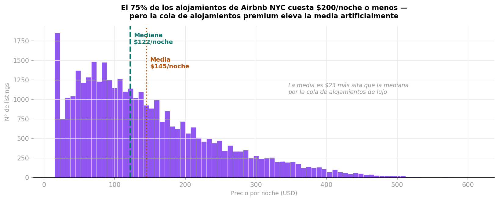
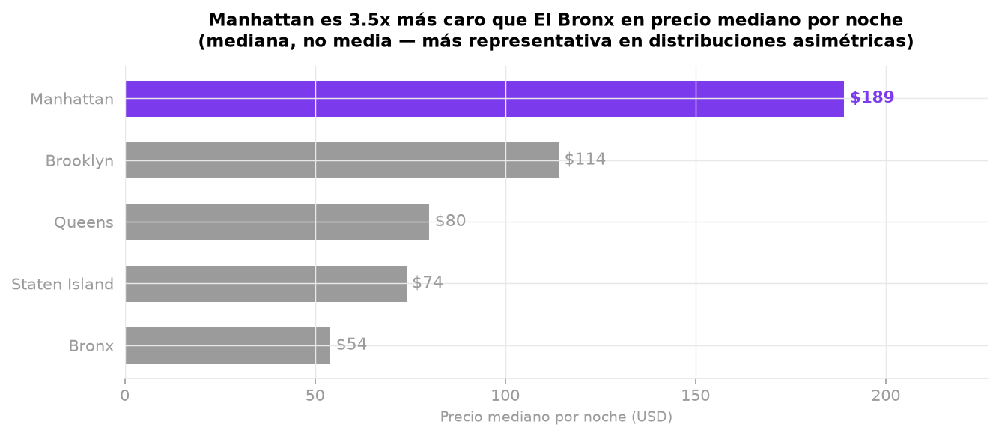
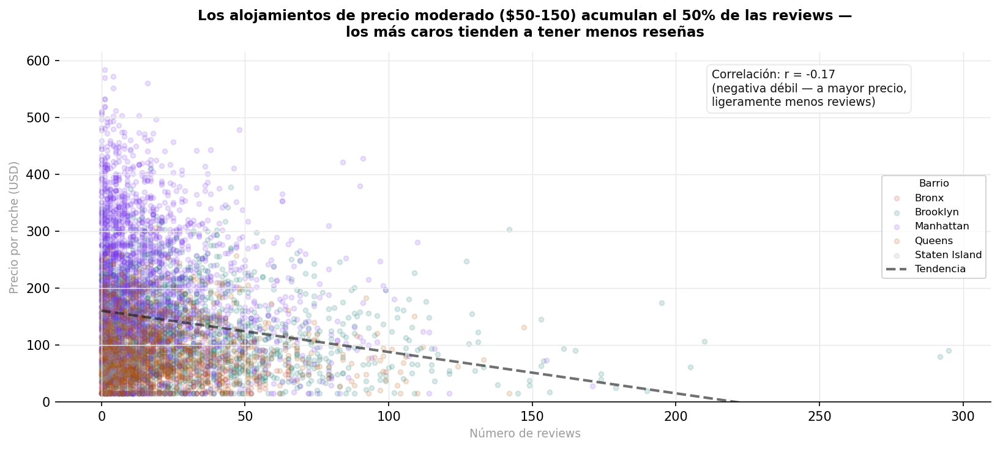
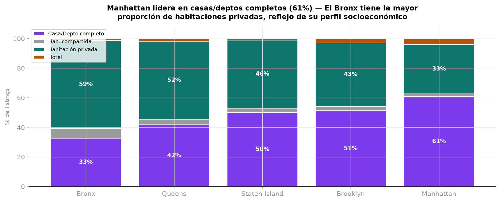
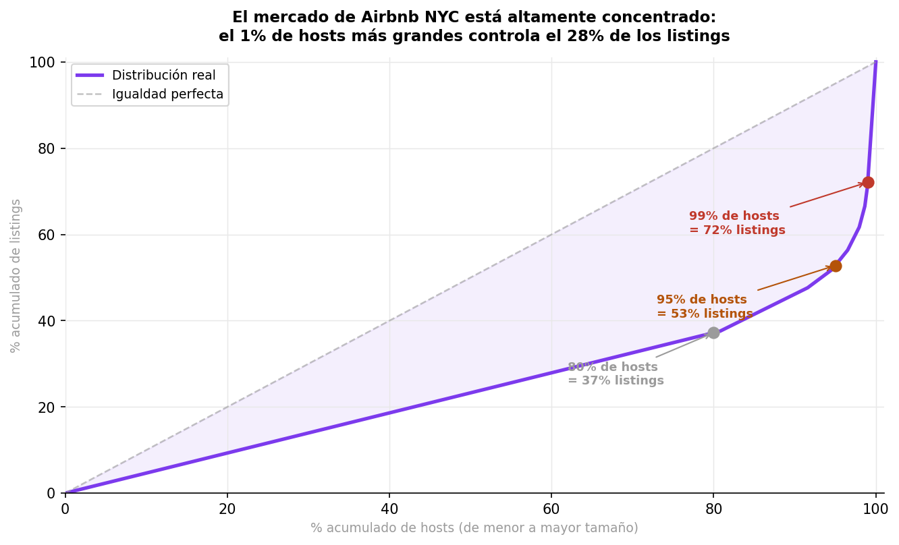

# Airbnb NYC 2024: Data Analysis & Market Insights

## Overview

Análisis exploratorio del mercado de Airbnb en Nueva York utilizando datos de 2024. El proyecto busca identificar patrones en precios, reviews, tipos de alojamiento y concentración de listings entre hosts.

Las visualizaciones fueron seleccionadas siguiendo principios del **framework de Cleveland & McGill**, priorizando el tipo de representación gráfica más adecuado según la tarea de análisis y comparación.

## Objectives

* Analizar la distribución de precios de los alojamientos.
* Comparar los precios entre diferentes barrios.
* Explorar la relación entre precio y número de reviews.
* Analizar la composición de los tipos de alojamiento por barrio.
* Evaluar la concentración de listings entre los diferentes hosts.

## Data

El dataset (`data/airbnb_nyc_2024.csv`) contiene **36,138 listings** de los 5 neighbourhood groups de NYC y **16,800 hosts**. Los precios van de $15 a $608 por noche.

> **Nota:** la columna `reviews_per_month` es igual a `number_of_reviews` en ~64% de las filas, por lo que no es confiable. El análisis no la utiliza.

## Visualizations

### 1. Distribución de precios



La distribución presenta una marcada asimetría hacia precios elevados.

* **Mediana:** $122 por noche
* **Media:** $145 por noche
* **75% de los listings:** ≤ $200 por noche

La diferencia de $23 entre la media y la mediana muestra que los alojamientos de precios elevados afectan considerablemente el promedio.

### 2. Ranking de barrios por precio



Existen diferencias importantes entre los barrios de NYC (precio mediano por noche).

* **Manhattan:** $189 por noche
* **Bronx:** $54 por noche

El precio mediano de Manhattan es aproximadamente **3.5 veces** el del Bronx.

### 3. Relación entre reviews y precio



Se observa una relación negativa débil entre el precio y la cantidad de reviews:

* **Correlación:** r = -0.170
* Los listings de **$50–150** acumulan el **50%** de todas las reviews.

Los alojamientos de mayor precio tienden a acumular menos reviews. Una posible explicación es una mayor rotación de huéspedes en el segmento económico, aunque esta relación no implica causalidad.

### 4. Composición por tipo de alojamiento



La composición del mercado varía considerablemente según el barrio.

| Barrio        | Casa/Depto completo | Habitación privada |
| ------------- | ------------------: | -----------------: |
| Bronx         |               32.7% |              59.4% |
| Queens        |               41.8% |              52.4% |
| Staten Island |               50.1% |              46.1% |
| Brooklyn      |               51.2% |              42.9% |
| Manhattan     |               60.8% |              33.3% |

Manhattan presenta una mayor proporción de alojamientos completos, mientras que en el Bronx predominan las habitaciones privadas.

### 5. Concentración del mercado



El mercado presenta una elevada concentración entre los hosts con mayor número de listings.

* El **1% de los hosts más grandes controla el 28%** de los listings.
* El **92% de los hosts** tiene únicamente 1–2 listings.
* El **80% de los hosts más pequeños** controla apenas el **37%** de los listings.

Esto sugiere la presencia de pocos operadores profesionales de gran escala junto con una amplia cantidad de hosts individuales.

## Key Takeaways

El análisis muestra que el mercado de Airbnb en NYC presenta diferencias importantes tanto en precios como en la estructura de la oferta.

**1. El precio típico está por debajo del promedio.**
La fuerte asimetría de precios hace que la mediana ($122) sea una medida más representativa del alojamiento típico que la media ($145).

**2. Existe una marcada diferencia geográfica.**
Manhattan presenta precios considerablemente superiores a los del resto del mercado, alcanzando aproximadamente 3.5 veces el precio observado en el Bronx.

**3. El mercado económico concentra mayor actividad de reviews.**
La correlación negativa entre precio y reviews sugiere que los alojamientos de menor precio tienden a acumular más reviews.

**4. La oferta cambia según el barrio.**
La proporción de alojamientos completos frente a habitaciones privadas varía significativamente entre los diferentes neighbourhood groups.

**5. El mercado está concentrado en pocos hosts grandes.**
Aunque la mayoría de los hosts son pequeños operadores, una proporción muy reducida concentra una parte considerable de los listings.

## Technologies

* Python
* Pandas
* NumPy
* Matplotlib
* Jupyter Notebook

## Project Structure

```text
airbnb-nyc-data-analysis/
│
├── data/
│   └── airbnb_nyc_2024.csv
├── notebooks/
│   └── analysis.ipynb
├── outputs/
│   └── figures/
│
├── .gitignore
├── requirements.txt
└── README.md
```

## How to Run

Clone the repository and install the required dependencies:

```bash
git clone https://github.com/JJva-06/airbnb-nyc-data-analysis.git
cd airbnb-nyc-data-analysis
pip install -r requirements.txt
```

Open the notebook:

```bash
jupyter notebook
```

Then open `notebooks/analysis.ipynb` and run all cells. The notebook reads the data and saves figures using paths relative to `notebooks/`, so it must be run from that folder (Jupyter does this by default).

## Methodology

The project follows an exploratory data analysis approach. Visualizations were selected based on the analytical task they needed to address, following the principles described by **Cleveland & McGill** regarding the effectiveness of graphical encodings for quantitative comparisons.

Each visualization is structured around:

**Business Question → Visualization → Justification → Insight**

## Author

José Villanueva
